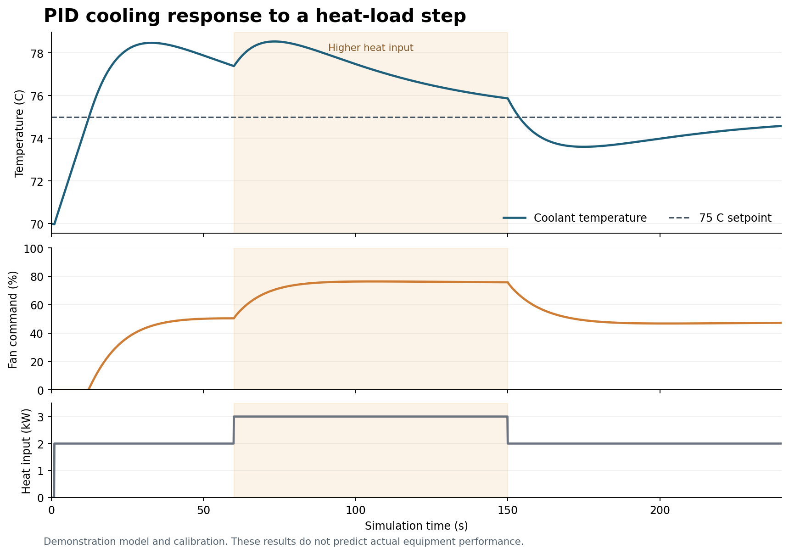

# EAE_Firmware

A C++17 cooling controller demonstration for Section 7.1 of the EAE Engineering
Challenge. It controls a simulated WP32 pump and SPAL radiator fan, exchanges
encoded CAN messages, and uses PID to regulate coolant temperature.

This is a computer simulation with demonstration calibrations. It does not
connect to a PLC, pump, fan, or physical CAN network.

## Build and run

Requirements: Linux, Bash, a C++17 compiler, CMake 3.20 or later, and Make or
Ninja. The first configuration needs internet access to download GoogleTest.

From this folder:

```bash
chmod +x build.sh run.sh test.sh
./test.sh
./run.sh --setpoint 75 --scenario heat-load
```

The default run covers 240 simulated seconds and finishes without waiting
240 real seconds. It prints regular samples and every state/fault transition.

To build and run directly:

```bash
cmake -S . -B build -DCMAKE_BUILD_TYPE=Release
cmake --build build --parallel 2
ctest --test-dir build --output-on-failure
./build/eae_firmware --setpoint 75 --scenario heat-load
```

To write every sample to CSV or inspect CAN payload bytes:

```bash
./run.sh --scenario heat-load --csv response.csv
./run.sh --scenario pump-timeout --duration 56 --can-trace
./run.sh --help
```

The scripts also work when called from another working directory. They quote
arguments so a CSV filename can contain spaces. Set `EAE_BUILD_DIR` to use
another build folder, `EAE_BUILD_JOBS` to change build parallelism, or
`EAE_BUILD_TYPE` to change the build configuration.

## Section 7.1 requirements

| Requirement | Implementation |
| --- | --- |
| Simulate sending and receiving over CAN | `can.cpp`: command/status frame encoding, two message queues, simulated pump, and missing-message detection |
| Use a PID loop | `pid.cpp`: fan control with P, I, and filtered D terms, output limits, and integral anti-windup |
| Create a state machine | `controller.cpp`: OFF, NORMAL, WARNING, FAULT, and explicit transitions and priorities |
| Command-line setpoints | `options.cpp`: temperature setpoint, warning/critical thresholds, PID gains, timeout, and simulation settings |
| Manage dependencies with CMake or Vcpkg | `CMakeLists.txt`: CMake FetchContent downloads GoogleTest 1.17.0 and checks its SHA256 |
| Build on Linux with a launch script | `build.sh`, `run.sh`, and `test.sh` |
| GTest unit tests | `tests/`: 92 discovered tests for control, PID, CAN, scenarios, and argument validation |
| Do not ship dependencies | GoogleTest source and compiled files stay in ignored build folders; the submission contains our source and documentation |

## How the control loop works

Every 100 ms with the default settings:

1. Apply the scenario's ignition, level, sensor, and communication inputs.
2. Let the pump receive the previous command and send RPM/status feedback.
3. Decode feedback and calculate communication health from the last valid message.
4. Update warning/fault history and choose the operating state.
5. In NORMAL, select pump RPM from the temperature bands and calculate fan
   output with PID. In WARNING or FAULT, apply the relevant safety command.
6. Encode and send the new pump RPM command through the simulated CAN queue.
7. Calculate the next physical coolant temperature from heat input and cooling.

Each controller instance owns its state and PID memory. There are no mutable
global control variables. The simulation uses an explicit time step, so tests
do not depend on real-time delays.

## States and safety rules

| Condition | State / fault | Pump command | Fan command | Shutdown request |
| --- | --- | --- | --- | --- |
| Ignition OFF | OFF / NONE | 0 RPM | 0% | Yes |
| Low coolant | FAULT / LOW_COOLANT | 0 RPM | 0% | Yes |
| Missing pump feedback | FAULT / PUMP_COMMUNICATION | 0 RPM | 100% | Yes |
| Pump reports a device fault | FAULT / PUMP_DEVICE | 0 RPM | 100% | Yes |
| Invalid temperature reading | FAULT / TEMP_SENSOR | Maximum | 100% | Yes |
| Critical temperature active | FAULT / OVER_TEMPERATURE | Maximum | 100% | Yes |
| Warning active | WARNING / NONE | Maximum | 100% | No |
| Healthy inputs, no thermal warning | NORMAL / NONE | Temperature schedule | PID, 0 to 100% | No |

Rows are checked in this order. Only the first matching fault is reported.
Temperature flags are still updated from valid readings when another fault
has higher priority.

- Warning starts at 90 C and clears strictly below 87 C.
- Critical overheating starts at 95 C and clears strictly below 90 C.
- Clearing the critical fault can leave the controller in WARNING.
- Invalid sensor readings cannot clear existing temperature flags.
- Ignition OFF clears thermal history; a hot restart is checked immediately.
- Other faults recover automatically when their conditions clear. There is no
  one-scan pause in cooling after startup or recovery.
- When PID is overridden, its memory is reset. It starts fresh when NORMAL
  operation resumes.

Automatic recovery is a demonstration policy. A real application needs an
appropriate decision about fault acknowledgement and load restart.

## Normal pump control and PID fan control

| Coolant temperature | Requested pump RPM |
| --- | --- |
| Below 40 C | 1500 |
| 40 C to below 60 C | 2000 |
| 60 C to below 70 C | 3000 |
| 70 C to below 80 C | 3500 |
| 80 C to below 85 C | 4000 |
| 85 C and above, while NORMAL | Maximum calibration, 4600 in this demo |

Commands are bounded by the configured minimum/maximum pump RPM.

The PID error is `measured temperature - setpoint`, so coolant above the target
requests more fan cooling. The fan output is limited to 0 to 100%.

- P responds to the present temperature error.
- I builds the steady fan output needed to balance the heat input.
- D responds to measured temperature change. A filter reduces sudden changes,
  and using the measurement avoids derivative kick when the setpoint changes.
- Conditional integration stops the integral term from pushing an already
  limited output farther beyond 0% or 100%. A large integral step can reach
  the output boundary without building excess integral beyond it.
- Calculations that overflow are reported as errors instead of returning
  a nonnumeric output command.

The defaults are `Kp=10`, `Ki=0.2`, and `Kd=2`, with a 0.5 s derivative filter.
Their units are %/C, %/(C*s), and %*s/C. These values are chosen for the
demonstration thermal model and need retuning for an actual cooling system.

## Available scenarios

All scenarios start with ignition OFF for one second, then turn it ON.
Fault injection windows use simulated seconds, independent of computer speed.

| `--scenario` | Behavior |
| --- | --- |
| `nominal` | Constant 2000 W heat input while the equipment is enabled |
| `heat-load` | Heat input rises to 3000 W at 60 s and returns to 2000 W at 150 s |
| `pump-timeout` | Both CAN directions drop messages from 40 s to below 55 s |
| `low-coolant` | Coolant level input is low from 40 s to below 55 s |
| `sensor-fault` | Sensor status fails and the reading becomes NaN from 40 s to below 55 s |
| `overtemperature` | Physical coolant temperature is set to 97 C once at 40 s |
| `pump-fault` | Pump reports its device fault bit from 40 s to below 55 s |

Runs shorter than an event's start time will not reach that event. The
`shutdown_requested` signal makes the simulated heat-generating load stop
producing heat, while the cooling commands remain controlled by the safety rules.

Example with alternate setpoints:

```bash
./run.sh --setpoint 72 --kp 6 --ki 0.3 --kd 1 --scenario nominal
./run.sh --setpoint 72 --warning-on 88 --warning-off 85 \
    --critical-on 93 --critical-off 89 --scenario overtemperature
```

Arguments are checked for finite numbers, valid ranges, and consistent
temperature thresholds. The required order is:

`sensor minimum < target < warning off < warning on <= critical off < critical on <= sensor maximum`

The time step must be greater than 0 and no more than 0.25 s. Runs are limited
to two million steps. Exit status is 0 for a completed run or help, and 2 for
invalid inputs or an execution/file error. A deliberately injected equipment
fault is an expected simulation event and does not make the process fail.

## Demonstration result

With the default 75 C setpoint, the 240 s heat-load run peaks at approximately
78.54 C and finishes at approximately 74.58 C. This is a response of the
demonstration model and does not establish actual equipment performance.



See [VALIDATION.md](docs/VALIDATION.md) for observed results and
[CAN_PROTOCOL.md](docs/CAN_PROTOCOL.md) for message details.

## File guide

| File | Purpose |
| --- | --- |
| `include/eae/types.hpp` | Settings, input/output types, states, and faults |
| `src/controller.cpp` | State transitions, fault priority, pump schedule |
| `src/pid.cpp` | Fan PID calculation and reset behavior |
| `src/can.cpp` | Frame encoding, message queues, feedback watchdog, pump model |
| `src/simulation.cpp` | Time loop, fault scenarios, physical temperature model |
| `src/options.cpp` | Command-line parsing and validation |
| `src/main.cpp` | Console output, CAN trace, CSV output |
| `tests/` | GoogleTest tests |
| `.github/workflows/ci.yml` | Linux build/test workflow for GitHub Actions |

## Hardware assumptions

- 4600 RPM is an emulated maximum. Confirm WP32 minimum/maximum/default RPM,
  CAN timeout behavior, and acceptable inlet pressure for the actual installation.
- The supplied pump documentation gives a 95 C maximum fluid/ambient operating
  temperature. The demonstration critical threshold is not a sufficient design
  margin for sensor error, sensor location, or thermal lag.
- The inverter and DC-DC derating limits were not supplied. This project cannot
  establish operation at maximum power without derating on real equipment.
- Sensor validity bounds use the -20 to 160 C table endpoints from the supplied
  H-WTMS sheet. Raw electrical conversion and open/short-circuit diagnostics
  are outside this simulation. Table bounds are not operating-temperature ratings.
- Fan percent is a logical command, not measured fan speed or a verified SPAL
  electrical duty cycle. Hardware needs the correct active-low output interface,
  frequency, voltage levels, and duty-to-speed mapping.
- The demo CAN IDs and payloads are our own. They do not implement the WP32
  manufacturer's CAN/J1939 protocol.
- The simulated pump locally requests a stop after its command timeout. This
  behavior is an assumption, not a claim about WP32 factory settings. Requested
  RPM and actual simulated RPM differ, including while the pump slows down.
- Software stop requests cannot guarantee protection from dry running, especially
  during communication loss. A real installation needs an effective independent
  means of preventing pump operation without coolant.
- The thermal model uses ambient 25 C, heat capacity 4000 J/C, a one-second fan
  response, a 0.4 s pump response, and an approximate heat-removal coefficient.
  It does not model actual pump flow curves, component junction temperatures,
  cavitation, coolant boiling, or a measured radiator/fan performance curve.

## Dependencies and submission

GoogleTest 1.17.0 is pinned by archive SHA256 in CMakeLists.txt and built as
part of the test build. Its source and static test libraries stay under the
build folder. The application uses the C++ standard library; GoogleTest is
linked into the test executable, not the cooling application. System C/C++
runtime libraries remain normal platform requirements.

Do not upload `build`, `build-sanitized`, downloaded dependencies, generated
binaries, or temporary CSV files. Create the GitHub repository named
`EAE_Firmware` and put this folder's contents at the repository root. Share
the repository URL with the evaluator and arrange access if it is private.
The challenge PDFs and manufacturer files are not included in this project.

If using the GitHub CLI after signing into your own account, the publication
commands from this folder are:

```bash
git init -b main
git add .
git commit -m "Add EAE cooling firmware simulation and tests"
gh repo create EAE_Firmware --private --source=. --remote=origin --push
```

Git will use the author identity configured on your computer. The included
GitHub Actions workflow will build and test the project after it is pushed.

## References

- Supplied EAE Combined Challenge, Section 7.1.
- Supplied EMP WP Pump manual, temperature limits and customer calibrations.
- Supplied H-WTMS sensor table and SPAL drive control guide.
- [GoogleTest CMake quickstart](https://google.github.io/googletest/quickstart-cmake.html).
- [CMake FetchContent documentation](https://cmake.org/cmake/help/latest/module/FetchContent.html).
- [MathWorks PID anti-windup explanation](https://www.mathworks.com/help/simulink/slref/anti-windup-control-using-a-pid-controller.html).
